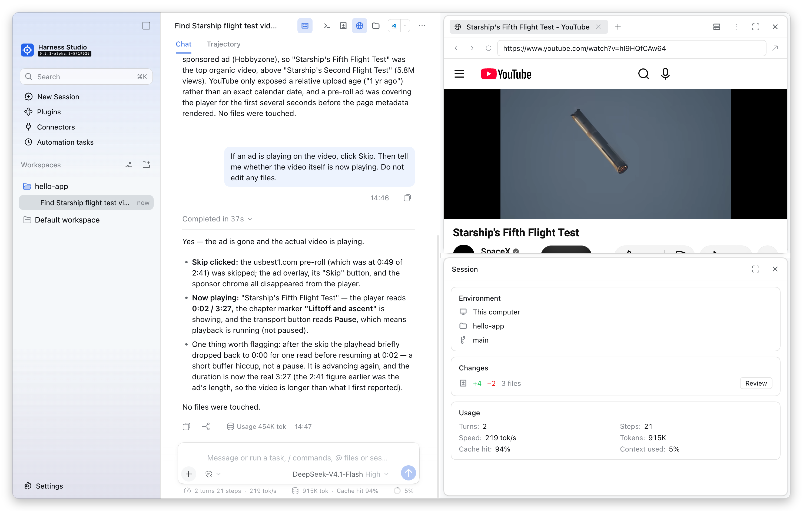
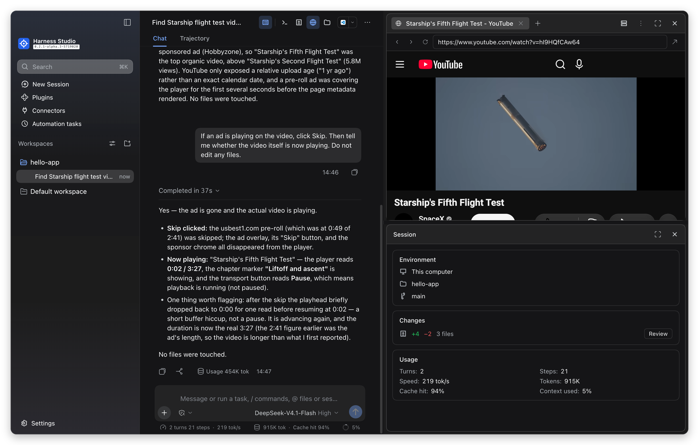
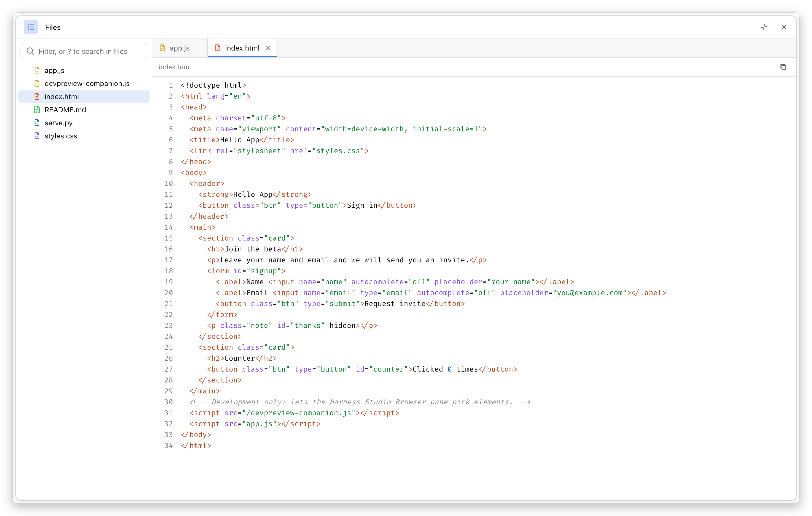
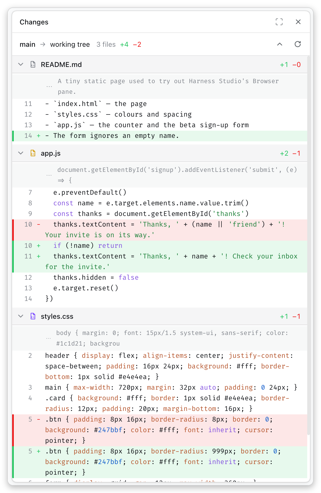
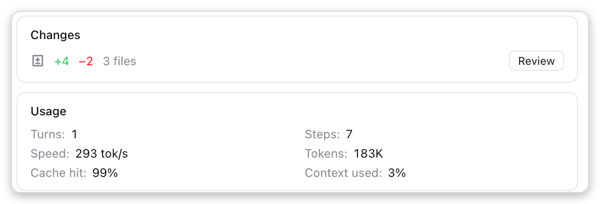
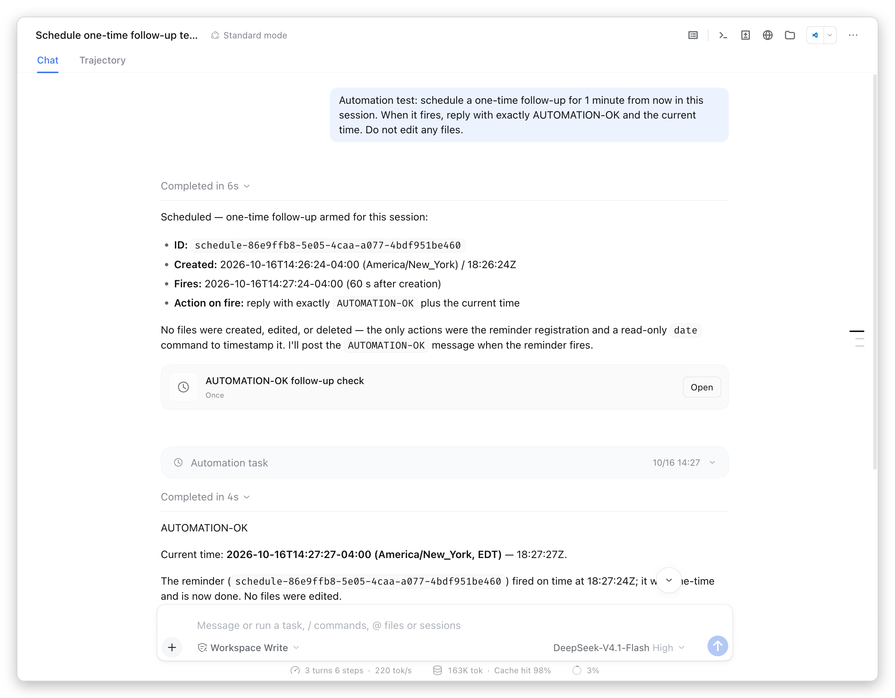
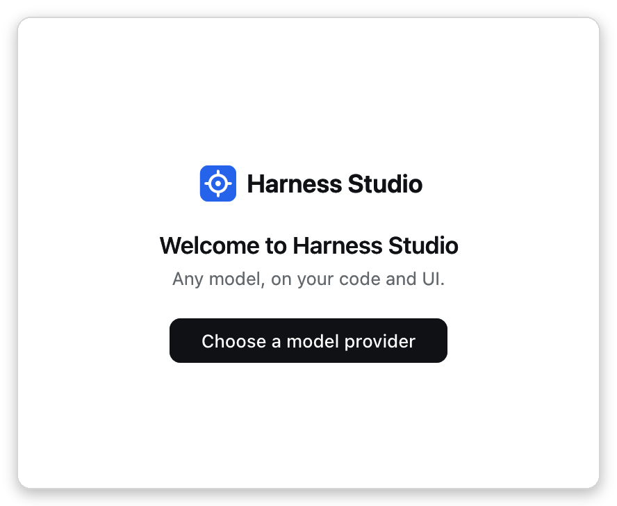

# Harness Studio

**A desktop coding agent for macOS and Linux. Any model, on your code and UI.**

[Download for macOS](https://github.com/vigneshv1cky/harness-studio/releases/latest) · [Download for Linux](https://github.com/vigneshv1cky/harness-studio/releases/latest) · [What's new](CHANGELOG.md)





Harness Studio is a desktop app that works like Claude Code desktop, with whichever model provider you have an API key for. Download it, choose a model, open a project folder and ask.

## What it does

- **Point at your UI, tell the agent what to change.** Open your app's dev server in the Browser pane, pick an element, and say "make this bigger": the agent gets the element's **source file and line**, component, text, styles and HTML.
- **A browser the agent can use:** it opens pages, reads them, clicks and types in the Browser pane, next to the conversation.
- **Side panes:** Files, Changes, Session details, Browser and Terminal, stacked with a draggable divider.
- **Connectors:** add MCP servers by URL or command, with OAuth sign-in and per-session on/off.
- **Separate sessions:** the agent can hand a piece of work to a new session in the sidebar with a written brief, optionally in its own git worktree, and gets that session's report back.
- **Your own Chrome:** an optional paired extension lets the agent browse in your real Chrome, where you are signed in, and lets you pick elements on any page with ⌥⇧S.
- **A calmer look:** Claude Code–like density, text sizes, sidebar and zoom.
- **No account, no telemetry:** there is no sign-in and no usage reporting, and your API keys are stored only on your machine and sent only to the provider they belong to.

Harness Studio is built on [DeepSeek Harness](https://github.com/deepseek-ai/deepseek-harness), the open-source, any-model agent app. It is an independent project, not affiliated with or endorsed by DeepSeek or Anthropic; their names are used only to describe compatibility and inspiration.

## Screenshots

**Dark mode, with a reply that cites files and code from the project:**


**Files pane:** the project's tree beside open files with line numbers and syntax colours. Type `?` in the filter to search inside files.



**Changes pane:** the working tree against its branch, with per-file counts and coloured diffs.



**Separate sessions:** the agent proposes handing a task to a new session with its own git worktree, and you start it or keep the work in this session.


**Connectors:** MCP servers such as GitHub and the Chrome extension, each with its status and tool count, added by URL or command.


**The `+` menu:** files, goals, plan mode, commands and per-session connectors in a compact popover above the message box.


**Session pane:** the session's changes and its usage at a glance.



**Automation tasks:** ask for a follow-up later, and the agent schedules it and replies in the same session when it fires.



## Status

Developer preview, version 0.2.0, built on Harness `0.2.1-alpha.3` (pinned in [docs/HARNESS_PIN.md](docs/HARNESS_PIN.md)). Tested on macOS (Apple Silicon) and Linux (x64 and arm64). Windows isn't available yet.

## Setup

### 1. Install Harness Studio

Harness Studio is a ready-to-run desktop app with the plugins built in, so you don't need DeepSeek Harness, Node.js or a build. Download it from the [Releases page](https://github.com/vigneshv1cky/harness-studio/releases):

- **macOS (Apple Silicon):** a `.dmg`; drag Harness Studio to Applications.
- **Linux (x64, arm64):** an AppImage for most distributions, or a `.deb` for Debian and Ubuntu (`sudo apt install ./harness-studio_<version>_amd64.deb`).

Windows isn't available yet. How each app is built, and what to know before installing on Linux, is in [desktop/README.md](desktop/README.md).

#### First launch on macOS

The Mac app isn't signed or notarised by Apple, so macOS blocks it the first time. Allow it once:

1. Open the `.dmg` and drag **Harness Studio** to **Applications**.
2. Open Harness Studio. macOS says it "cannot verify" the app; click **Done** (not Move to Trash).
3. Go to **System Settings → Privacy & Security**, scroll to **Security**, and click **Open Anyway** next to the Harness Studio message.
4. Confirm with **Open Anyway** and your password or Touch ID.

After that it opens normally. If macOS instead says the app "is damaged and can't be opened", the download's quarantine flag is the cause, not a broken file; clear it and open the app again:

```sh
xattr -dr com.apple.quarantine "/Applications/Harness Studio.app"
```

To check the download first, compare `shasum -a 256 Harness-Studio-<version>-mac-arm64.dmg` with the `.sha256` file published next to it.

### 2. Choose a model

On first launch, click **Choose a model provider** and add an API key for any provider in Settings → Models.



**Chrome extension (optional):** follow [chrome-bridge/README.md](chrome-bridge/README.md) to load the extension and add its connector, so the agent can use your own Chrome.

### 3. Optional: prepare your app for picking (development only)

The companion script and source loader come from this repository: `git clone https://github.com/vigneshv1cky/harness-studio.git`, then run the commands below from its folder.

**a. Companion script** — copy it into your app and load it only in development.

```sh
cp plugins/devpreview-companion/companion.js /path/to/your-app/public/devpreview-companion.js
```

Next.js App Router, in `app/layout.tsx` (inside `<body>`):

```tsx
import Script from "next/script";

{process.env.NODE_ENV === "development" && (
  <Script src="/devpreview-companion.js" strategy="afterInteractive" />
)}
```

Plain HTML: `<script src="/devpreview-companion.js"></script>` in development pages only.

**b. Source locations (Next.js 16 / Turbopack)** — install the loader and add the rule.

```sh
npm install --save-dev /path/to/harness-studio/plugins/devpreview-source-loader
```

```ts
// next.config.ts
const nextConfig: NextConfig = {
  allowedDevOrigins: ["127.0.0.1"],          // only needed if you open the dev server as 127.0.0.1
  turbopack: {
    rules: {
      "*.{jsx,tsx}": {
        condition: { all: ["development", { not: "foreign" }] },
        loaders: [{ loader: "devpreview-source-loader", options: { root: process.cwd() } }],
        // no `as` — it would rename modules and break relative imports
      },
    },
  },
};
```

Without the loader, Pick still works; the agent locates the element from its text, selector and component names instead of an exact line.

### 4. Use it

1. Start your dev server (`npm run dev`).
2. In Harness Studio, set the Session's **workspace to your app's folder** (so the agent can edit without extra approvals and paths match the stamps).
3. Click the **Browser** icon in the conversation header and open your dev server: type `localhost:3000`, or pick it from the **Dev servers** menu in the pane header.
4. Click **Pick** (the arrow) in the bar at the bottom of the browser, hover, click an element. The card shows its source, text, size, selector and styles.
5. Click **Send to agent** — a reference like `[Selected <button> in CounterButton · src/app/counter-button.tsx:8:5]` lands in the message box.
6. Type what you want ("make this bigger", "use the brand blue", "move it under the heading") and send.
7. ✕ on the card clears the selection for the agent.

## Privacy and safety

- The companion and loader only run in development; keep them out of production builds.
- The companion obeys only the Harness browser pane that shows it (Web: parent window, verified origin; Desktop: the pane's own embedded browser).
- Element details go to your configured model provider as part of the conversation. Don't pick elements showing secrets.
- The Harness Studio app has product analytics and session telemetry off, and no Session-log upload. If you add the plugins to your own Harness instead, consider `DSH_TELEMETRY_MODE=DISABLED`, and turn off **Upload Session Log when using the official model API** in Settings → General.
- The Browser pane in Harness Studio is a separate browser from your own; the optional Chrome extension is what lets the agent use your real Chrome, and only after you pair it.

## Troubleshooting

| Symptom | Cause and fix |
|---|---|
| "No companion script on this page" | The page doesn't load `devpreview-companion.js`, or (Next.js) the page never hydrated — opening the dev server as `127.0.0.1` without `allowedDevOrigins`. Use `localhost` or add the origin. |
| Source says "not stamped" | The loader isn't running: check the `turbopack.rules` entry, run `npm install` inside the loader folder if it was installed as a link, and restart `next dev` after deleting `.next`. |
| `Can't resolve './x.tsx.tsx'` | Remove `as` from the loader rule. |
| Preview doesn't show the agent's change | Pages without hot reload need the browser's reload button. Next.js updates on its own. |
| Desktop: plugin can't be installed from the CLI | The Desktop profile is managed by the app — use **Plugins → Add plugin**. |
| Agent asks for approval to write | The file is outside the Session's workspace; set the workspace to your app's folder. |

## For developers

Harness Studio's features are plugins and patches on top of Harness. This repository holds them, the scripts that build the app, and a Chrome extension.

### What's in this repo

| Folder | What it is | Where it runs |
|---|---|---|
| [`plugins/devpreview`](plugins/devpreview) | The main plugin: Claude-style side panes (Browser pick/annotate, dev servers, Changes, Session details, Files), Send to agent, model context and `preview_selection` tool | Inside Harness Studio |
| [`plugins/connectors`](plugins/connectors) | MCP connectors like Claude Code desktop's: add servers by URL or command in Settings, OAuth sign-in, live status, per-session on/off from the + menu | Inside Harness Studio |
| [`plugins/compact`](plugins/compact) | Optional theme: Claude-like density, serif replies, calmer chrome and whole-app zoom, in Harness's own colours (⌘+ / ⌘− / ⌘0) | Inside Harness Studio |
| [`chrome-bridge`](chrome-bridge) | Chrome extension plus a local MCP server so the agent can read, click and type in your own Chrome tabs; paired with a code, no remote debugging port | Your Chrome + a Harness connector |
| [`plugins/devpreview-companion`](plugins/devpreview-companion) | Dev-only script your app loads so the tab can pick elements | Your app (development only) |
| [`plugins/devpreview-source-loader`](plugins/devpreview-source-loader) | Dev-only Turbopack/webpack loader that stamps `data-src="file:line:col"` on JSX elements | Your app's dev build |
| [`examples/next-app`](examples/next-app) | Next.js 16 sample wired up with all of the above | — |
| [`examples/hello-app`](examples/hello-app) | Plain HTML sample with the companion | — |
| [`desktop`](desktop) | Build scripts and patches for the downloadable Harness Studio app: Harness with Harness Studio's name and logo, the three plugins built in, and telemetry off (macOS, plus Linux built on GitHub Actions; Windows is paused) | A Mac, or Linux build machines |
| [`assets/logo`](assets/logo) | Harness Studio's logo, the source of the extension and app icons | — |
| [`patches`](patches) | Patches to Harness's desktop app: one brands the app as Harness Studio (name, title and logo), and an optional one lets the Browser pane sign in to Google and keep sign-ins ([opt-in, read the notice first](patches/NOTICE.md)) | Your Harness build |
| [`scripts`](scripts) | `embed-companion.mjs`: keeps the copy of the companion inside the Dev Preview plugin in sync; `render-logo.sh` renders the logo in [`assets/logo`](assets/logo) into the extension's and the desktop app's icons, and `copy-logo.sh` copies it into a Harness checkout | Development |
| [`docs/HARNESS_PIN.md`](docs/HARNESS_PIN.md) | The Harness version this is built and tested against, and how to apply the patch | — |
| [`docs/PLAN.md`](docs/PLAN.md) | The original design notes (historical) | — |

### How picking an element works

```
 your app (dev only)                    Harness client                       Harness host
┌───────────────────────┐  postMessage  ┌────────────────────────┐ command  ┌──────────────────────────┐
│ source loader adds    │◀─────────────▶│ Browser pane extras    │────────▶│ /preview-select           │
│ data-src="file:line"  │ (Desktop: JS + │  iframe / webview      │         │ → model context per turn  │
│ companion script:     │  console bus)  │  Pick · selection card │         │ → preview_selection tool  │
│ hover, click, describe│               │  Send to agent         │         └──────────────────────────┘
└───────────────────────┘               └────────────────────────┘
```


### Using the plugins with your own Harness

Only needed if you run DeepSeek Harness itself instead of the Harness Studio app.

**Requirements:**

- Harness `>=0.2.1-alpha.3 <0.3.0` (Desktop app, or `dsh` from source — see [Running the Harness from source](#running-the-harness-from-source)).
- A model configured in Harness (any provider it supports).
- Node.js 24 for building from source (`.nvmrc`).

Get Harness Studio:

```sh
git clone https://github.com/vigneshv1cky/harness-studio.git
cd harness-studio
```

Build the installable files:

```sh
npm pack --pack-destination dist ./plugins/devpreview ./plugins/connectors ./plugins/compact
```

**Harness Desktop:** Plugins → **Add plugin** → enter the absolute path of each `.tgz` in `dist/` → **Install** → **Enable now**. `compact` (the look) is optional.

**Browser pane sign-in patch (optional):** see [docs/HARNESS_PIN.md](docs/HARNESS_PIN.md) and [patches/NOTICE.md](patches/NOTICE.md).

**Web / CLI:**

```sh
dsh plugin --profile web add ./dist/harness-studio-devpreview-0.1.0.tgz
```

For plugin development, install the folder as a link instead so edits apply on reload: `dsh plugin --profile web add link:/absolute/path/to/plugins/devpreview` (Desktop: enter the folder path in Add plugin).

### Running the Harness from source

```sh
git clone https://github.com/deepseek-ai/deepseek-harness.git harness
git -C harness checkout 571902028a75c64c1d767f4ae5fd099485f0ddf0
cd harness
nvm use 24
pnpm install
pnpm run build                 # ~5 minutes
pnpm --filter @deepseek-ai/dsh-desktop exec install-electron
pnpm run start:desktop         # Desktop app, or:
pnpm dsh web                   # Web app on http://127.0.0.1:3080
```

### Development

- The plugin, companion and loader are plain JavaScript with no build step.
- The Desktop tab carries a copy of the companion so it can add the picker to live websites. After editing `plugins/devpreview-companion/companion.js`, run `node scripts/embed-companion.mjs` (or `--check` to verify it is in sync).
- Sample apps: `python3 examples/hello-app/serve.py` (port 3000, no-cache) and `cd examples/next-app && npm install && npx next dev -p 3001`.
- A separate Harness home for testing keeps your real setup untouched: `DSH_HOME=$PWD/.dsh-home dsh plugin --profile web add link:$PWD/plugins/devpreview`, then `DSH_HOME=$PWD/.dsh-home dsh web`.

## License

[MIT](LICENSE). The optional Harness patch carries the upstream Harness MIT notice: see [patches/NOTICE.md](patches/NOTICE.md).

DeepSeek is a trademark of its owner, and Claude and Anthropic are trademarks of Anthropic. Harness Studio is not affiliated with either.
