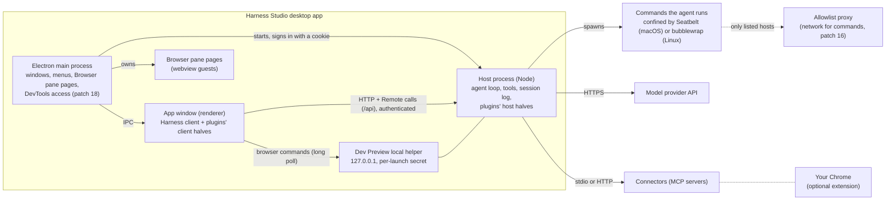
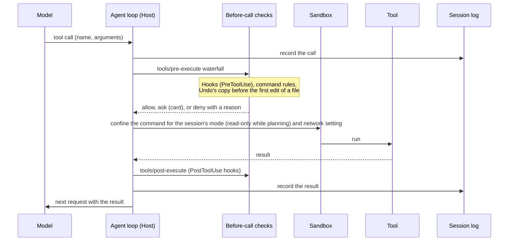
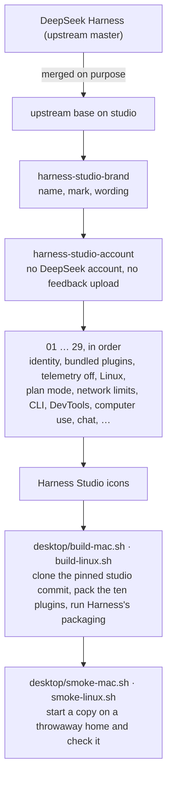

# Architecture

How Harness Studio is put together, for contributors. Harness Studio is [DeepSeek Harness](https://github.com/deepseek-ai/deepseek-harness) through its own fork, [harness-studio-core](https://github.com/vigneshv1cky/harness-studio-core), at a pinned commit ([HARNESS_PIN.md](HARNESS_PIN.md)), changed in two ways:

- **Plugins** in [`plugins/`](../plugins) add features through Harness's own extension points. They are ordinary Harness plugins and also work in a stock Harness install.
- **Commits on the fork's `studio` branch** change Harness itself where no extension point exists: the name, the bundled plugins, the sandbox's network limits, DevTools access to the Browser pane, and so on. They started as the patch files in [`patches/`](../patches) and [`desktop/patches/`](../desktop/patches), one commit per patch, which stay as a fallback for now. Upstream releases are merged into `studio` ([FORK_PLAN.md](FORK_PLAN.md)).

Everything below describes the desktop app. The plugins also run in Harness's Web app, except where noted.

## Processes



- **Electron main process** (`apps/desktop/src/main.ts` in Harness): creates the window, starts the Host and signs the window in to it, and owns the Browser pane's pages. Each page is leased to the window that shows it. Patch 18 lets that window send an allowed set of DevTools commands to pages it leases, on pages on this computer or the local network only. Patch 19 removes earlier launches' sign-in cookies before signing in.
- **Host process**: Harness's Node runtime, made of Cordis plugins. It runs the agent loop, the model requests, every tool, the sandbox and the session log, and serves the window's web client on `127.0.0.1` at a port chosen at each launch. Plugins' host halves (`index.js`) load here.
- **App window**: Harness's React client. Plugins' client halves (`client.js`) load here and draw into named slots: right-panel tabs, Settings items, the conversation header, turn footers.
- **Commands the agent runs** are separate processes, confined by the operating system: Seatbelt on macOS, bubblewrap on Linux. Under "Only allowed sites" their traffic goes through a small proxy that admits only the listed hosts.
- **Dev Preview's local helper** answers git queries for the Changes and Files panes, and relays browser commands from the Host to the window showing the session. Only callers that prove the per-launch secret are answered.

## One tool call



Every model request, tool call and result is written to the session log before the next step, so a session can be resumed, branched or compacted exactly. The before-call checks are a waterfall: each listener can decide (allow, ask, deny) or pass the call on.

## A plugin

```
plugins/<name>/
  package.json        npm package; its "dsh" field names the bundle patch and the client half
  cordis.patch.yml    adds the host half to the Host's plugin tree
  index.js            host half: tools, services, event listeners (optional)
  client.js           client half: tabs, panes, settings, buttons (optional)
  README.md           what it does, its limits, how it works
  test/*.test.mjs     node --test, no Harness needed for the pure parts
```

- A host half exports a name, the services it needs (`inject`) and an `apply` function that registers tools and listeners. Every registration is disposed of when the plugin unloads.
- A client half calls the window's module loader and registers slot components. The window talks to the Host through Remote calls that the host half provides; nothing goes through the conversation unless it should be seen by the model.
- The downloadable app ships ten plugins, listed in [desktop/README.md](../desktop/README.md). They are always on and do not appear on the Plugins page.

| Plugin | Host half | Client half |
|---|---|---|
| [Dev Preview](../plugins/devpreview) | browser tools, element selection, local helper | side panes (Files, Changes, Session, Browser extras), pane toolbar |
| [Connectors](../plugins/connectors) | MCP server management, OAuth | Settings page, per-session switches |
| [Compact](../plugins/compact) | network-for-commands setting, asking before new sites, your-data list | the look, About page, Settings rows |
| [Sessions](../plugins/sessions) | separate sessions and worktrees | the hand-off's tool view and message-box status |
| [Remember](../plugins/remember) | notes, auto memory, Instructions page data | Instructions page, note cards |
| [Hooks](../plugins/hooks) | Claude Code–style hooks and command rules | — |
| [Undo](../plugins/undo) | copies before the first edit in a turn | Undo button under turns |
| [Watch](../plugins/watch) | change-triggered checks | eye button and list |
| [Terminal](../plugins/terminal) | full-screen programs for the agent | — |
| [Editor](../plugins/editor) | file open, check and save | Editor tab |

## The fork



Each commit is titled with the name of the patch it came from; what each one changes is in the table in [desktop/README.md](../desktop/README.md#patches). A commit carries the matching Harness tests when it changes tested behaviour.

## Data on disk

Everything is local; nothing is sent anywhere except model requests to the provider you configured, and connector traffic to the servers you added.

| Location | Contents |
|---|---|
| `~/.harness-studio/sessions/` | One folder per workspace, one log per session: every message, tool call and result |
| `~/.harness-studio/.credentials.yaml` | Provider keys and connector sign-ins |
| `~/.harness-studio/settings.yaml` | Settings |
| `~/.harness-studio/memory/` | Auto memory, one folder per project |
| `~/.harness-studio/hooks.json` | Your hooks |
| `~/.harness-studio/storages/` | Workspaces, schedules and caches |
| `~/.harness-studio/harness-studio/` | The plugins' own files: Undo copies, connectors, sessions, worktrees, watches, network setting, hook approvals |
| `~/.harness-studio/profiles/` | Which plugins load in the app and the command-line tool |
| `~/Library/Application Support/Harness Studio` (macOS), `~/.config/Harness Studio` (Linux) | The window's own data: Browser pane cookies and storage, caches |

A different home folder can be chosen with `DSH_HOME`.

## Where to start

- A new tool or pane: start from the closest plugin above and its README.
- A change Harness has no extension point for: a commit on the fork's `studio` branch, with tests, a row in the desktop README's table, and a new `Pinned commit:` in [HARNESS_PIN.md](HARNESS_PIN.md).
- Harness's own architecture: `docs/architecture.md` inside a Harness checkout.
