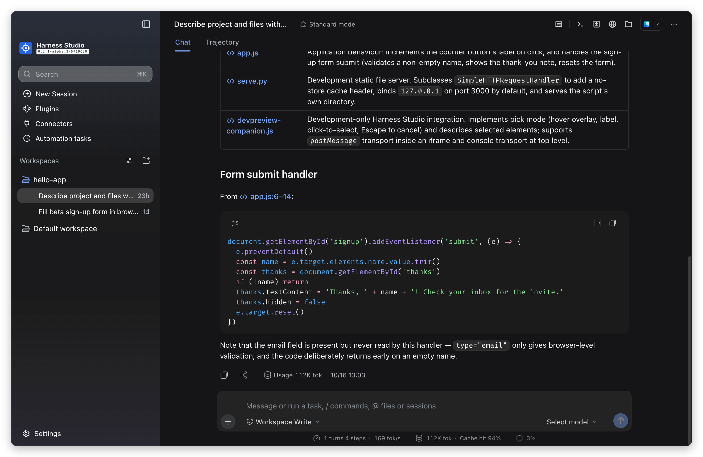
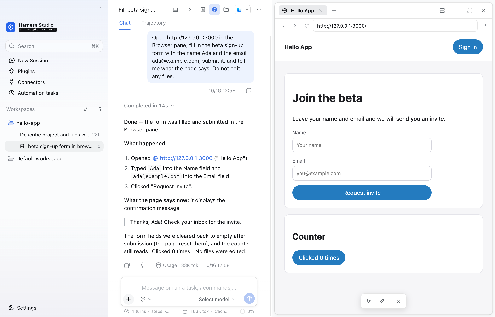
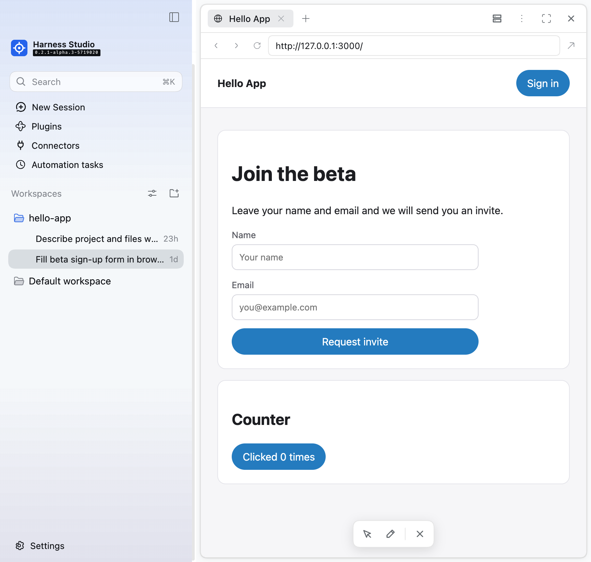

# @harness-studio/compact

A Claude-like feel for [Harness Studio](../../README.md) in Harness's own colours: denser spacing, serif replies, calmer chrome, plus whole-app zoom.

## What it changes

- **Conversation:** 22px line height (was 24px), 10px paragraph and message gaps (was 16px), tighter code blocks and user bubbles.
- **Composer:** smaller corners and padding, compact send button, smaller stats line.
- **Right sidebar start page:** compact entry rows instead of large cards.
- **Zoom:** ⌘+ / ⌘− / ⌘0 (Ctrl on Windows/Linux) scale the **whole app**, like Claude's desktop app, in Chrome-style steps from 67% to 200%; the level is remembered. While zoomed, the theme converts every element position, pointer position and window size Harness reads into the zoomed layout's units, so column drags, menus and popovers line up at any zoom; the space beside the macOS window buttons is kept at its real size. This replaces Harness's text-only size shortcut; text size is still adjustable in Settings.

- **Conversation like Claude Code desktop's:** replies at 14px on a 22px line in the chosen chat font, 16px between paragraphs, tables like Claude's (14/20px text, 6×11px cell padding, a rounded 1px border and row lines at 10% of the text colour, a header in the cells' weight on a 5% fill, kept inside the text column with wrapping cells instead of Harness's sideways-scrolling wide tables), code blocks and inline code at 13/19px (Harness draws blocks at 11px), wide tables kept inside the chat area, 12px between transcript items, and one centred 768px column shared by the transcript and the message box, at least 40px from the pane edges.
- **Clearer lines on full pages:** on Plugins, Connectors, Automation tasks, Instructions, About and the Git page, the border colours behind separators and boxes are 8, 16, 20 and 24% of the text colour instead of Harness's 4 to 16%, so rows and sections stand apart; the conversation and dialogs keep Harness's lines. The colours mix from the text colour, so every theme and both schemes follow. Harness's own Plugins and Automation tasks lists sit in rounded, bordered sections with a line between rows, like the Instructions page (Connectors and the Git page do the same in their own plugins).
- **Always allow a website:** the new-site approval card gets a third button, **Always allow for this website**, between Reject and Allow once. Harness's approval has a single grant (allowed once, which the session log records), so the button first saves the site through the Host, which accepts only a site an approval card is asking about right now, and then answers the card with Allow once. Saved sites live in `<harness home>/harness-studio/sites.json` (exact site names, no wildcards, at most 500); calls to them and pages on them pass without asking. **Settings → General → Always-allowed sites** lists them with Remove.
- **Prompt history:** Up in the message box steps back through the prompts you sent (newest first) when the box is empty or the cursor is at its very start; while a recalled prompt is unchanged, Up and Down keep stepping, and Down past the newest brings back your draft. Any edit ends the stepping; the / and @ menus and input-method composing keep their keys. Prompts sent with Enter or the send button are kept in this window's storage (the last 200, no repeats in a row) and set through the editor itself, so a recalled prompt sends like a typed one.
- **Colour themes:** **Settings → General → Colour theme**, just below Appearance, adds Warm (Claude-like ivory and clay), Graphite, Nord, Solarized and High contrast to the default look. Each theme has a light and a dark palette, so Appearance still picks light, dark or system. A theme's colours go through Harness's own theme service as one override layer on its colour tokens (backgrounds, borders, text, hover and selection fills, accent, links, code and tooltips), and under a theme the left sidebar takes the theme's sidebar colour instead of the default blue-and-violet gradient. The choice is remembered on this computer, and the app starts in it: the theme's colours for the current Appearance (both schemes for System) are kept as a boot style that the desktop page adds before its first paint (Harness patch 26), and removed once the theme layer takes over. With the default theme in dark mode the boot style holds Harness's dark page colour, so dark mode does not start white either.
- **Chat font of your choice:** **Settings → General → Chat font**, just below Font size, sets the typeface for messages and replies from presets in four groups — sans-serif (System, the default, plus Helvetica Neue, Avenir Next, Verdana, Gill Sans, Optima, Rounded, Noto Sans, DejaVu Sans), serif (New York, Georgia, Charter, Iowan Old Style, Palatino, Baskerville, Noto Serif), monospace (Fira Code, SF Mono, Menlo, JetBrains Mono, DejaVu Sans Mono) and playful (Comic Sans, Chalkboard, Marker Felt, Trebuchet) — each offered only when installed, or the name of any installed font. Each is drawn with the platform's normal smoothing on a 22px line, and the choice is remembered on this computer. Code keeps its code font.
- **Calmer chrome:** a hairline composer edge and a quieter header line.
- **Narrower left sidebar on demand:** drag its edge down to 230px (Harness stops at 264px), close to Claude Code desktop's width; sessions sit indented under their folder. The word **More** at the foot of the sidebar is centred, with its dots kept at the left, and its menu opens centred over it. The width is remembered; double-click the edge to return to Harness's own width. Column drags cover the window while they run, so crossing the Browser pane's page doesn't swallow them.
- **Claude Code desktop's sizes at 100%** (measured from its window): 13px for the conversation title and message-box controls; 14px on a 20px line for replies, your messages and the message box. The left sidebar uses Claude's 13px text with 12px session times on slightly tighter 26px rows, so more sessions fit beside the Instructions and About rows.
- **Long messages fold:** a message you sent that runs past about ten lines shows its start with a fade and **Show more** at the start of its time-and-copy row (always shown, in the time's grey); **Show less** folds it again, as in Claude Code desktop.
- **Left sidebar top, like Claude Code desktop:** a **Search** field sits where the New Session button was and searches session names as you type (Enter opens the first match, Esc clears, ⌘K jumps to it); **New Session** becomes a row like **Plugins** and **Automation tasks**. The field drives the Workspaces header's own search, which stays hidden.
- **Right sidebar, like Claude Code desktop's side panes:** a slim header with a hairline under it; borderless 26px tabs, the active one in a soft fill, close buttons on hover; the start page as a plain menu instead of bordered cards.
- **Side panes as cards:** each right-sidebar pane is a rounded, bordered card on the sidebar fill, like Claude Code desktop; the browser pane gets a roomier navigation row and a bordered address field.
- **One control per pane:** the conversation header's pane icons open and close panes (the Preview plugin stacks up to two, top and bottom), so each pane header shows only its own title, a fullscreen button and a × that closes it — no tab strip, no new-tab button, no side-by-side split, no second collapse button. The browser pane is the exception: its tabs and + stay, like Claude's browser.
- **No layout motion:** opening or closing a sidebar happens in one step; the centre column no longer eases sideways and the right panes no longer slide in.
- **Panels and popups that stand apart, like Claude Code desktop:** Harness draws menus 58% transparent with almost no shadow, so they melt into the white behind them. Menus, lists and dialogs are now solid with Claude's popover shadow (24px blur at 12% plus 6px at 8%; stronger in dark mode), and the side panes and message box are white with Claude's panel shadow.
- **About page:** an **About** row under **Settings** at the foot of the sidebar opens a page explaining every Harness Studio feature: what it does, how it works and why, with a list of what is not there yet.
- **Network for commands:** **Settings → General → Network for commands**, after Permission, chooses On, Off or Only allowed sites (with an editable list) for commands the agent runs. The Host half of this plugin (`index.js`) saves the choice in `<harness home>/harness-studio/network.json`, which the sandbox policy reads before each command (desktop patch 16); the setting has no effect without that patch.
- **Asking before new sites:** web fetch (`web_fetch`), Browser pane pages the agent opens (`browser_open`) and pages it opens in your Chrome (the Chrome connector's `chrome_open`) ask before reaching a site for the first time in a session, through Harness's approval prompt; rejecting it stops the request before anything is sent. Sites on this computer pass, and so do the sites on the Network for commands list while it is set to Only allowed sites (matched as the command proxy matches them). A site allowed once is reached without asking for the rest of that session while the app runs; full access lifts the check. The Host half (`site-approval.js`) does this with a `tools/pre-execute` listener that lets other listeners decide first, and a `tools/execute` listener that remembers a site once its call runs; the two are tied by the call itself (Harness passes the same object to both), not by its id, which providers reuse. A call whose address is not text (a list, say) is refused, since the tools would turn it into text unchecked. Pages can move to another site by themselves (a redirect, a script, a clicked link, a local page included), so the plugin also offers its check as a service (`harnessStudioSiteApproval`), and the Browser pane checks the address each step ended up on, leaving a site not approved in the session; the request to that site has been made by then. The setting file is saved one write at a time through a uniquely named temporary file, so concurrent saves cannot leave a broken file. It needs no Harness patch, so it also works in your own Harness; the command-line tool, which does not load this plugin, does not ask. Tests: `node --test plugins/compact/test/*.test.mjs`.
- **Replies like Claude Code's, in your own instructions:** on the first start the Host half writes Harness Studio's default reply style (`default-agents.md`) as your global instruction file, `<harness home>/AGENTS.md`, which the Instructions tab lists as "Global, all projects": lead with the answer, keep length to the request, use lists, tables and headings only when the content has that shape, link files with workspace-relative paths, give a one-line note before a batch of tool calls, and finish with what changed and how it was checked, saying plainly what failed or was not verified. It is written once, only when you have no such file (`default-instructions.js` leaves a marker in `<harness home>/harness-studio/`), so a file you already have is kept and one you edit or delete is never rewritten. Harness's own system prompt says nothing about tone or format, so nothing conflicts.
- **Sidebar scrollbar:** a visible grey thumb in both themes while the pointer is over the sidebar.
- **Colours:** Harness's own palette and blue accent, untouched, in both themes.

## Install

Desktop: **Plugins → Add plugin** → the folder `plugins/compact` or a packed `.tgz` → **Install → Enable now**.
Web / CLI: `dsh plugin --profile web add ./harness-studio-compact-0.2.0.tgz`.

Turn it off on its Plugins page to get the stock look back.

## Compatibility

Harness styles use generated CSS-module class names (`gBsEha_panelRow`). The theme matches the stable part after the underscore (`panelRow`), so it survives rebuilds of the same version, but a Harness release that renames components can stop some rules from applying. Tested with `0.2.1-alpha.3`.
