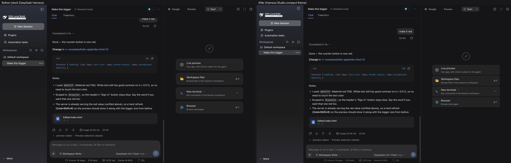
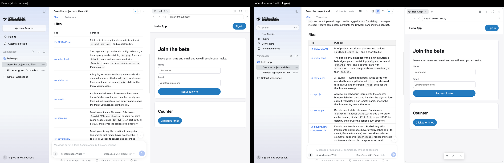
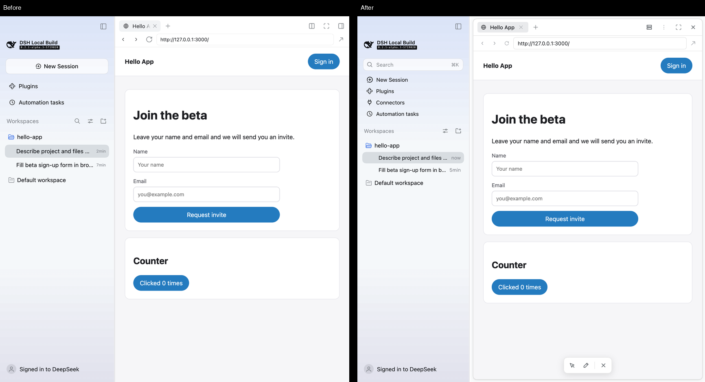

# @harness-studio/compact

A Claude-like feel for [Harness Studio](../../README.md) in Harness's own colours: denser spacing, serif replies, calmer chrome, plus whole-app zoom.

## What it changes

- **Conversation:** 22px line height (was 24px), 10px paragraph and message gaps (was 16px), tighter code blocks and user bubbles.
- **Composer:** smaller corners and padding, compact send button, smaller stats line.
- **Right sidebar start page:** compact entry rows instead of large cards.
- **Zoom:** ⌘+ / ⌘− / ⌘0 (Ctrl on Windows/Linux) scale the **whole app**, like Claude's desktop app, in Chrome-style steps from 67% to 200%; the level is remembered. While zoomed, the theme converts every element position, pointer position and window size Harness reads into the zoomed layout's units, so column drags, menus and popovers line up at any zoom; the space beside the macOS window buttons is kept at its real size. This replaces Harness's text-only size shortcut; text size is still adjustable in Settings.

- **Conversation like Claude Code desktop's:** replies in the system sans at 14/20px (measured from Claude Code desktop at 100%) at regular weight with the app's antialiased smoothing, as Claude draws its text, 16px between paragraphs, tables like Claude's (14/20px text, 6×11px cell padding, a rounded 1px border and row lines at 10% of the text colour, a header in the cells' weight on a 5% fill, kept inside the text column with wrapping cells instead of Harness's sideways-scrolling wide tables), code blocks and inline code at 13/19px (Harness draws blocks at 11px), wide tables kept inside the chat area, 12px between transcript items, and one centred 768px column shared by the transcript and the message box, at least 40px from the pane edges.
- **Calmer chrome:** a hairline composer edge and a quieter header line.
- **Narrower left sidebar on demand:** drag its edge down to 230px (Harness stops at 264px), close to Claude Code desktop's width; sessions sit indented under their folder. The word **More** at the foot of the sidebar is centred, with its dots kept at the left, and its menu opens centred over it. The width is remembered; double-click the edge to return to Harness's own width. Column drags cover the window while they run, so crossing the Browser pane's page doesn't swallow them.
- **Claude Code desktop's sizes at 100%** (measured from its window): 13px for the sidebar, session names, search, conversation title and message-box controls, on 28px rows, with session times kept at 12px (Claude shows none); 14px on a 20px line for replies, your messages and the message box.
- **Long messages fold:** a message you sent that runs past about ten lines shows its start with a fade and **Show more** at the start of its time-and-copy row (always shown, in the time's grey); **Show less** folds it again, as in Claude Code desktop.
- **Left sidebar top, like Claude Code desktop:** a **Search** field sits where the New Session button was and searches session names as you type (Enter opens the first match, Esc clears, ⌘K jumps to it); **New Session** becomes a row like **Plugins** and **Automation tasks**. The field drives the Workspaces header's own search, which stays hidden.
- **Right sidebar, like Claude Code desktop's side panes:** a slim header with a hairline under it; borderless 26px tabs, the active one in a soft fill, close buttons on hover; the start page as a plain menu instead of bordered cards.
- **Side panes as cards:** each right-sidebar pane is a rounded, bordered card on the sidebar fill, like Claude Code desktop; the browser pane gets a roomier navigation row and a bordered address field.
- **One control per pane:** the conversation header's pane icons open and close panes (the Preview plugin stacks up to two, top and bottom), so each pane header shows only its own title, a fullscreen button and a × that closes it — no tab strip, no new-tab button, no side-by-side split, no second collapse button. The browser pane is the exception: its tabs and + stay, like Claude's browser.
- **No layout motion:** opening or closing a sidebar happens in one step; the centre column no longer eases sideways and the right panes no longer slide in.
- **Panels and popups that stand apart, like Claude Code desktop:** Harness draws menus 58% transparent with almost no shadow, so they melt into the white behind them. Menus, lists and dialogs are now solid with Claude's popover shadow (24px blur at 12% plus 6px at 8%; stronger in dark mode), and the side panes and message box are white with Claude's panel shadow.
- **Colours:** Harness's own palette and blue accent, untouched, in both themes.

## Install

Desktop: **Plugins → Add plugin** → the folder `plugins/compact` or a packed `.tgz` → **Install → Enable now**.
Web / CLI: `dsh plugin --profile web add ./harness-studio-compact-0.2.0.tgz`.

Turn it off on its Plugins page to get the stock look back.

## Compatibility

Harness styles use generated CSS-module class names (`gBsEha_panelRow`). The theme matches the stable part after the underscore (`panelRow`), so it survives rebuilds of the same version, but a Harness release that renames components can stop some rules from applying. Tested with `0.2.1-alpha.3`.
