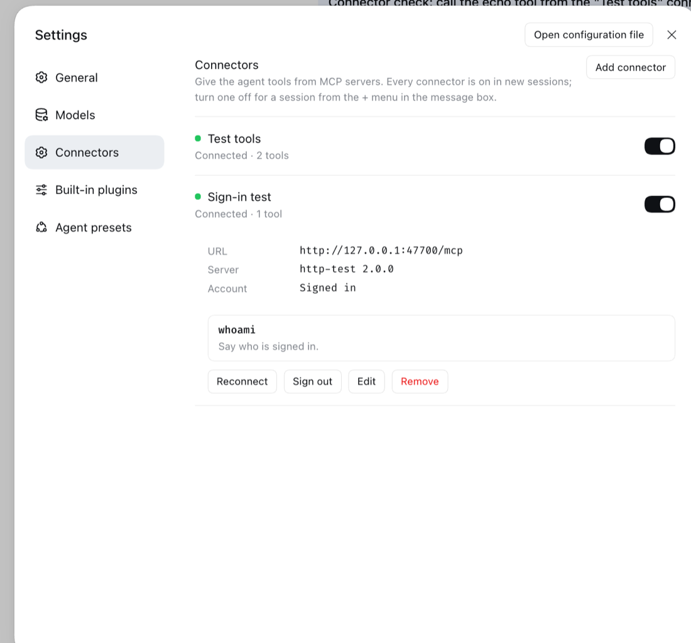
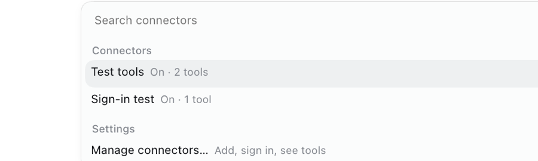

# @harness-studio/connectors

MCP connectors for [Harness Studio](../../README.md), like Claude Code desktop's: add MCP servers by URL or command from Settings, sign in with OAuth, see live status and tools, and turn each connector on or off per session from the message box's **+** menu.





## What it adds

- **Connectors in the left sidebar.** A **Connectors** entry under **Plugins** opens the same list as a full page, laid out like the Plugins page. Settings → Connectors stays as well.
- **Settings → Connectors.** Add a connector by **Remote URL** (Streamable HTTP, or the older SSE transport) or **Local command** (a stdio server such as `npx -y @modelcontextprotocol/server-filesystem /path`). Each row shows a status dot, `Connected · N tools`, `Needs sign-in`, `Connecting…` or `Not connected · <reason>`, and an on/off switch. Expand a row for its URL or command, server name and version, its tools in a two-column table (tool, what it does) drawn like the app's Markdown tables, and **Reconnect**, **Sign out**, **Edit** and **Remove**; **Edit** opens the form in the row's place. On the Connectors page the connector list is one rounded, bordered section with a line between connectors.
- **Sign in.** A server that answers `401` shows **Sign in**. The plugin discovers the server's authorization server, registers itself as a client when the server allows it, and opens your browser; after you approve, the browser returns to a page served by Harness and the connector connects. Tokens are refreshed automatically. Servers that do not register clients take an **OAuth client ID** (and secret, if their app has one) in the connector's form; servers that use API keys take **Headers** instead.
- **GitHub, with no setup.** GitHub's MCP server (`https://api.githubcopilot.com/mcp/`, also the **GitHub** quick-add button in the form) does not register clients, so the plugin ships its own GitHub OAuth app, "Harness Studio", and signs in with GitHub's device flow: **Sign in** shows a code (and copies it), opens github.com/login/device, and connects once you approve. The app has no client secret and its tokens do not expire; revoke them from GitHub → Settings → Applications.
- **+ menu → Connectors.** Lists every connector with its state for the current session (`On · 12 tools`, `Off in this session`, `Needs sign-in`). Picking one turns it on or off for that session only, or signs in / retries / turns it on when that is what it needs. **Manage connectors…** opens the Settings page.
- **Ask before calls.** Each connector's form has **Ask before calls**: **Never** (the default), **Before calls that can change things**, or **Before every call**. A call that asks waits for your approval in the conversation, through Harness's own approval prompt; rejecting it means the server is never called. **Before calls that can change things** relies on the server's own read-only labels (the MCP `readOnlyHint` annotation), which MCP itself calls untrusted hints: a tool counts as unable to change things only when its server marks it read-only, and, for a server that is not on this computer (a URL off `localhost`), only when its name also starts with `get`, `list`, `read`, `search`, `fetch`, `find`, `query`, `describe`, `show` or `view`; anything else asks. A local server that labels a tool wrongly can still skip the prompt, so use **Before every call** for one you do not trust. Other approval rules and hooks decide first, and full access, which turns approval prompts off, lifts it.
- **What the agent sees.** A connector's tools are offered to the model as `mcp__<connector>__<tool>`, the same names Harness's built-in MCP client uses, only in sessions where the connector is on. Results reach the model as text. Images (PNG, JPEG, WebP or GIF, up to 10 MB per result) are stored in Harness's attachment store and shown to the model with the text when the session's model accepts images, as Harness's own MCP client does; otherwise, and for audio, a short note says what was left out and why.

## Install

Desktop: **Plugins → Add plugin** → the folder `plugins/connectors` (or a packed `.tgz`) → **Install → Enable now**.

Web / CLI:

```sh
dsh plugin --profile web add link:/absolute/path/to/plugins/connectors
```

## How it works

| Part | File | Role |
|---|---|---|
| Connection | `mcp-connection.js` | Its own MCP client (JSON-RPC 2.0, protocol 2025-06-18, accepts 2025-03-26 and 2024-11-05): stdio child process, Streamable HTTP with JSON or SSE answers, or legacy HTTP+SSE for URLs ending in `/sse` and servers that refuse a Streamable initialize. Tracks status, retries a failed connection after 1, 3, 10 and 30 seconds, re-lists tools on `notifications/tools/list_changed`. |
| Sign-in | `oauth.js` | MCP authorization: protected-resource metadata (RFC 9728) → authorization-server metadata (RFC 8414 / OpenID discovery, then default paths) → dynamic client registration (RFC 7591) → authorization code with PKCE S256 and the `resource` indicator (RFC 8707) → token exchange and refresh. A client secret goes in HTTP Basic, or in the form body when the server refuses Basic. Device authorization (RFC 8628) for the built-in apps. |
| Storage | `store.js` | Connectors and per-session choices in `<Harness home>/harness-studio/connectors.json` (owner-only, replaced atomically). Sign-in grants in Harness's credential store as `harness-studio-connectors/<id>` records. |
| Host | `index.js` | Holds the built-in OAuth apps (GitHub), starts connections, registers tools on each session's agent scope (`agent.ctx.tools`) and disposes them when a connector is turned off for that session, disconnected or removed. Serves the `harnessStudioConnectors/helper` Remote method that tells the Client the helper's port and key. |
| Helper | `helper.js` | A small HTTP API on `127.0.0.1:47620` (next free port up to 47624) for the Client half, plus the OAuth redirect page. Every API request needs the per-launch key. |
| Client | `client.js` | The Settings page (`settings.section`), the sidebar entry and its page (`sidebar.panellist`, `main`), and the + menu entry (`ctx.commandUi`). Gets the helper's port and key from `ctx.connection`. |

Harness generates Remote declarations only for in-tree packages, so the plugin's own API is the HTTP helper. The helper is not open to whoever can reach 127.0.0.1: at each launch the Host half makes a random 256-bit key and offers it, with the port, through one argument-free Remote method (`harnessStudioConnectors/helper`) on Harness's API Gateway. The Client calls it with `ctx.connection.rpc.call('/api', 'harnessStudioConnectors/helper', { args: {} })`, which travels over Harness's own authenticated Client↔Host channel (the Desktop carrier, or the Web launch token), and then sends the key in the `x-connectors-key` header on every helper request. The method uses the Gateway's source-mode discovery (a Service with a `typertRemote` binding and the versioned `@Remote` marker on its prototype), because an out-of-tree plugin has no generated descriptor; non-owner Peers (shared remote access) are refused by the Gateway's access policy. A Client therefore only ever talks to its own Harness's helper, even with several Harness instances running.

## Privacy and safety

- The helper listens on 127.0.0.1 only and requires its own address in the `Host` header (so a rebinding DNS name cannot reach it). Every API request must carry the per-launch key described above, which only the Harness Client receives; a request without it gets `401`, so another local process cannot add a command connector or read connector settings. API requests must also come from the Harness app's origins (`dsh-app://app`, and `http://127.0.0.1:3080` / `http://localhost:3080` for Web), and writes must be JSON.
- Secret values never leave the Host half. The connector list shows header and environment variable names with their values masked (`••••••••`) and the OAuth client secret only as set or not set. When you edit a connector, a line left as `Name: ••••••••` keeps the saved value, a new value replaces it and a deleted line removes it; a blank client secret keeps the saved one unless you tick **Remove the saved secret**. An edit that points a URL connector at another origin (scheme, host or port) carries none of the saved values over: masked headers and the client secret are dropped unless you type them again, and the page says which were dropped, so one server's API key or token is never sent to another.
- The OAuth redirect page completes only a sign-in this Harness started, matched by its random `state`, within ten minutes. Signing out or removing a connector cancels a sign-in, refresh or device-code poll in progress; its result is discarded, never saved.
- Remote connectors must use `https://`; plain `http://` is accepted only for `localhost`, `127.0.0.1` and `[::1]`. The same rule applies to every OAuth endpoint the server advertises (authorization, token, registration, device), and only such URLs are handed to the system browser. Protected-resource metadata is used only when its `resource` is the connector's URL or a path prefix of it on the same origin, authorization-server metadata only when its `issuer` matches the issuer it was looked up for, and a server that lists its PKCE methods must include S256. A legacy SSE server's message endpoint must be on the server's own origin, since headers and the token are sent there.
- Refreshes for one connector run one at a time, also across an edit that replaces the connector's connection, and the rotated tokens are saved before the next one starts, so a server that rotates refresh tokens never sees the same one twice. Ending a connection (an edit, a removal, quitting) never refreshes a token just to tell the server the session is over. A new sign-in that finds a different authorization server or token endpoint drops the old tokens at once, so an abandoned sign-in cannot send the old refresh token, or the client secret, to the new endpoint.
- A server cannot make Harness hold an unbounded answer: one message (a JSON body, an event-stream event, a stdio line) is capped at 16 MB. Past it the request fails with that reason, or for a stdio server and the legacy event stream the connection does.
- A refresh that fails because of the network, a timeout or a server error keeps the sign-in and is retried 30 seconds later. Only a refused refresh token (`invalid_grant`, or a bare 400/401 from the token endpoint) drops the tokens and asks you to sign in again.
- A local-command connector runs that command with your user's permissions, like any MCP server you configure by hand. It does not inherit Harness's whole environment: only `PATH`, `HOME`, `USER`, `LOGNAME`, `SHELL`, `TERM`, `TMPDIR`, `LANG` and `LC_*` (on Windows also `PATHEXT`, `SystemRoot`, `SystemDrive`, `windir`, `ComSpec`, `TEMP`, `TMP`, `USERPROFILE`, `USERNAME`, `USERDOMAIN`, `HOMEDRIVE`, `HOMEPATH`, `APPDATA`, `LOCALAPPDATA`, `ProgramData`, the `ProgramFiles` and `CommonProgramFiles` variables, `NUMBER_OF_PROCESSORS`, `PROCESSOR_ARCHITECTURE` and `OS`), plus the variables set on the connector. Add anything else a server needs, such as a proxy (`HTTPS_PROXY`) or an API key, to the connector's **Environment**.
- Connectors do not ask before calls by default. They reach services you added and signed in to, but a prompt injection (in a README, a web page or a connector's own results) can have the agent put what it has read into a call that sends it on, such as a message, an email or an issue. Set **Ask before calls** on a connector that can send things where others can read them. The Chrome connector's `chrome_open` asks before each new site in a session whatever this setting says (the Compact plugin's site check).
- **The Chrome bridge's link key.** For a connected Harness Studio Chrome bridge, the helper route `GET /chrome-bridge-link` (helper key required, like every route) reads the bridge's per-launch link key over its stdio pipe (the resource `harness-studio://chrome-bridge/link`) and returns `{ port, key }`; this plugin's window shares it as `window.__harnessStudio.chromeBridgeLink` for the Dev Preview plugin, which signs its pick polls with it. Without a connected, listening bridge it returns `{}`.
- On Windows a command that resolves to an `.exe` runs directly; a `.cmd`/`.bat` (such as `npx`) runs through `cmd.exe` with every argument quoted and escaped, and turning the connector off ends the whole process tree (`taskkill /T /F`).
- Header and environment values are stored in the owner-only settings file; tokens in Harness's credential store. If `connectors.json` is not valid JSON, it is renamed to `connectors.json.corrupt-<time>` and an error is logged, and the plugin starts with an empty list; fix that file and move it back to restore your connectors. If the file cannot be read at all (for example, permissions), changes are refused until it can, so it is never overwritten.

## Large connectors load their tools on demand

A connector with more than 10 tools has them held back, like Claude Code's deferred tools. Instead of every tool's schema riding along on every request, the agent gets one `connector_tools` tool that lists the held-back tools by name; it loads the ones a task needs, by name or by a search, and calls them from its next step. Loaded tools stay for the rest of that session. Connectors with 10 or fewer tools register them directly, as before. With GitHub's 49 tools connected this cut a request's tool definitions from 95 KB to 42 KB, about 13,000 tokens.

## Tests

`test/run.mjs` drives the Host half with a stand-in Harness context against two test servers: a stdio server and a Streamable HTTP server that is also its own OAuth authorization server. `test/bin/open` stands in for the browser and follows the sign-in redirect, so nothing opens on screen. It checks connection and status, per-session tool registration, **Ask before calls** (each setting, read-only tools, an earlier denial, full access), a missing command, sign-in, SSE answers, token refresh, persistence across a restart, sign-out and removal, and the safety rules: requests without the helper key are refused, secret values never appear in answers and survive masked edits, id collisions and leftover grants, a refresh network failure keeps the sign-in while `invalid_grant` drops it, OAuth metadata and endpoint validation, the legacy SSE endpoint origin, the stdio environment allowlist and a corrupt settings file. It also checks images in results (attached for a model with image input, noted otherwise), the stricter read-only rule for remote servers, that an edit or a quit with an expired token never spends a refresh token twice nor refreshes to end a session, that an edit to another origin drops saved secrets and says so, that a sign-in with another authorization server drops the old tokens when it starts, and the 16 MB caps on a JSON answer, an event-stream line and a stdio line. The helper takes the first free port from 47620, so it runs beside a Harness that already holds one.

```sh
node plugins/connectors/test/http-server.mjs &
PATH="$PWD/plugins/connectors/test/bin:$PATH" node plugins/connectors/test/run.mjs
```

Run both from the repository root, and stop the test server afterwards.

## Known limitations

- Resources, prompts, sampling, roots and elicitation are not supported; servers' requests for them are declined.
- Audio in tool results, and images when the session's model does not accept them, reach the model as a text note.
- The server's instructions text is not added to the system prompt.
- Subagents get each connector according to their own session, which defaults to on.
- The Settings nav entry shows Harness's generic settings icon; Harness picks nav icons from a fixed list.
- "Manage connectors…" opens Settings by clicking through **More → Settings**, since Harness exposes no call to open a Settings page.
