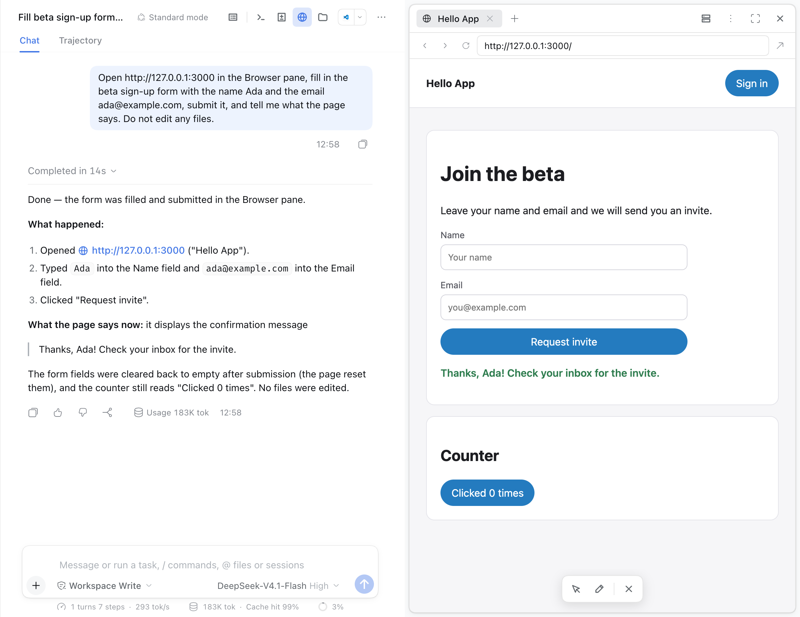

# @harness-studio/devpreview

A [Harness Studio](../../README.md) plugin that makes the right sidebar work like Claude Code desktop's, and lets you point the agent at an element of your running app:

1. **Browser pane extras** — Harness's Browser pane gains Claude's tools:
   - **Pick** an element for the agent and **Annotate** the page (draw on a screenshot and attach it to your message), two buttons in the pane header beside Dev servers and ⋮, so nothing floats over the page (they are greyed out until a page is open);
   - a **Dev servers** menu in the pane header: dev servers detected on this computer (ports 3000, 3001, 5173, 5174, 4200, 4321, 8000, 8080, 8888) and servers you add;
   - a **⋮** menu: open in the default browser, copy URL, save screenshot, viewport (responsive, mobile 390, tablet 768, desktop 1280), hard reload, developer tools, clear page data;
   - **Detect dev server** on the empty browser page.
2. **Pick → Send to agent** — with the dev-only [companion script](../devpreview-companion) in your app, hover outlines elements; clicking one shows its source file and line, component, text, size, selector and styles. **Send to agent** puts a reference in the message box, so "make this bigger" edits the right file. The pane accepts a pick only right after you turn pick mode on (the first element the page reports, nothing before or after), and validates and trims it with the same rules as the Host. Pick mode ends when the pane loads a new page, so a page you navigated to cannot answer a pick you started on another. While picking, the press itself is held back from the page (pointer, mouse and touch), so picking a menu trigger or a drag handle does not open or drag it.
3. **Changes and Session details** — a Changes pane shows the Session folder's git working tree against its branch, laid out like Claude Code desktop's: pinned file headers with type icons and +/− counts, small diffs expanded, one line-number column with coloured edge bars, wrapped lines and syntax colours ([screenshot](../../docs/screenshots/changes-pane.png)); and a Session card shows the environment, folder, branch and change totals. Its **Background tasks** card, last, below Usage, lists everything still working for the Session, like Claude Code desktop's: commands the agent left running in the background and workflows (Harness's jobs), subagents, programs in the agent's terminal and Watch's watches, each with how long it has been running and a stop button (stop the command, interrupt the subagent, end the program, remove the watch). Finished ones sit behind an "N finished" row, newest first, ten at a time with Show all. Stopped terminal programs and removed watches stay listed as finished until the app restarts. Both refresh every few seconds, and an open diff reloads whenever its file is written (even when the line counts stay the same). Line counts are worked out for up to 100 untracked files; beyond that they are listed without counts. Git data comes from a small read-only helper the Host half runs on `127.0.0.1` (ports 47613–47617), so refreshing never adds rows to the conversation. See [The local helper](#the-local-helper) for how it is secured.
4. **Files** — like Claude Code desktop's: a tree of the Session folder (`.git` hidden, re-listed every 5 seconds while the pane is on screen and when the window regains focus, keeping open folders open) beside tabs of open files with line numbers and syntax colours ([screenshot](../../docs/screenshots/files-pane.png)). The filter matches file names across the whole folder; start it with `?` to search inside files and jump to the matching line. Name filtering and search come from the same local git helper, so they need the folder to be a git repository. The list button at the left of the pane header hides or shows the tree, and dragging the tree's right edge changes its width (at least 160px, leaving at least 160px for the file; double-click to reset); both are remembered, and a width remembered from a wider pane is narrowed to fit a narrower one. With the Editor plugin installed, every file opens ready to edit in place, with syntax colours and ⌘S to save; each open-file tab keeps its own editor, shows a dot while it has unsaved changes, and asks before closing with unsaved changes. As in Claude's Files view, a single click opens a preview tab (its name in italics) that the next file you open replaces; editing it, double-clicking its tab, or double-clicking the file keeps it open, and a tab with unsaved changes is never replaced. Files the editor can't open (binary, over 2 MB, outside your workspace) show read-only, as they do without the plugin. Files the editor can't show open in Harness's own viewers inside the tab: PDFs, images, spreadsheets (Excel workbooks), and Word and PowerPoint documents, with the viewer's zoom, sheets, reload and open-in-app controls. The viewer's header is drawn like the Files tab's own file bar and shows the path relative to the Session folder. CSV and TSV files are text with a rendered form: they get the same **Rendered / Source** switch as Markdown, Rendered being a table in the app's table style built from the editor's text, every cell centred like the Excel viewer's (the first 1,000 rows, header row kept on screen). Web pages and SVG images get the switch too, Rendered being Harness's viewer (from the saved file). A file preview or Editor tab that still opens (restored from an earlier layout) is closed and its file opened here. Files the conversation opens, from a file card, a file link or a reference, open here too, at the line named, with the tree hidden until the tree button or the header's Files button brings it back (in full screen the tree shows unless it was hidden there, remembered apart); the separate file preview no longer opens. A Markdown file has a **Rendered / Source** switch in its bar: Rendered shows it formatted with Harness's own Markdown renderer, including edits not yet saved, and Source is the editor. A newly opened Markdown file starts in the view chosen last, remembered in browser storage under `harness-studio.markdown-view`, which Harness's file preview (the one a file card in the chat opens) shares. Text matches Claude Code desktop's at 100%: 13px on 24px tree rows, code at 13px. Under a video or audio player, a bar attached to it shows the time to a tenth of a second and a track with the marked part; **Set start** and **Set end** (or the I and O keys) mark a part, and **Add to message**, greyed out until both are set, puts the part into the message box as a reference ("[clip.mp4, 1:10.4 to 1:25.0]"), so you can ask the agent to cut, caption or GIF exactly that part; the agent does the editing.
   The Browser pane is for previewing local apps; the agent is told to browse websites in your own Chrome (the Chrome extension tools) and to use the pane only for local previews or when you ask for it. Google sign-in works in the pane with a password: a small Harness patch ([patches/harness-browser-pane.patch](../../patches/harness-browser-pane.patch), see [docs/HARNESS_PIN.md](../../docs/HARNESS_PIN.md)) gives it Claude desktop's identity shape (a plain `HarnessStudio/1.0` token before Chrome's, no Electron), a real outer window size, and storage that keeps sign-ins across restarts. Passkeys do not work in the pane: at "Complete sign-in using your passkey" choose "Try another way".
5. **Design** — the agent's design boards beside the chat. A board is the single HTML file the design-board skill writes at `designs/<topic>.board.html` in the Session folder ([format](../compact/skills/design-board.md)). While a Session is on screen and the window is visible, its header lists the folder's boards every 2 seconds through the local helper; the first listing only records them, and after that a board that is new or changed opens the Design pane (under the pane stacking rules) or switches it to that board, and reloads it at the zoom and position it was left at (a board left fitted to the width is fitted again). The pane header has a list of every board in `designs/`, newest first, and **Pick**. Clicking a screen's label, or any artboard while Pick is on, puts a reference such as `[designs/habit-settings.board.html, Home: compact list at 375 px]` in the message box; nothing is sent. The board runs its own script in a frame that may run scripts and nothing else (an opaque origin with no access to the app, its storage or the helper), and the helper adds a policy as the first thing in its head that stops its scripts from fetching, posting forms or opening sockets; web fonts, stylesheets and images still load from the internet. Screens ignore the pointer, so scrolling, dragging and Ctrl or ⌘ with scroll move and zoom the board wherever the pointer is; the board's **Use screens** button (Escape to stop) lets you click, type and scroll inside them. Each artboard reports its own height to the board (on load, when late fonts arrive and when it resizes; frames only grow, at most eight times, so a screen sized by the window height cannot grow for ever), so every screen shows at full length. The board tells the pane only a screen name and a width (checked and trimmed there; the file name comes from the pane), its zoom, and whether Pick is on. **Older boards:** boards written before the viewer reported clicks carry an older copy of the viewer, so every board is shown with the current viewer ([board-runtime.html](board-runtime.html), kept identical to the skill's copy by the tests) in place of whatever copy it has, found between its comment markers or, for the first version, from its style block to the end of its script. The file on disk is never changed. A board whose viewer the agent rewrote is shown as it is, with a note that clicking a screen cannot add a reference. Boards over 8 MB, links, and files outside `designs/` are not shown.
6. **Dashboards** — live dashboards beside the chat. A dashboard is a folder the dashboards skill writes in `dashboards/<name>/` ([skill](../compact/skills/dashboards.md)): `dashboard.html`, one refresh script per data source in `refresh/` (`.sh`, `.py`, `.mjs` or `.js`, printing JSON) with any files they use, and the last data in `data/<source>.json`. While a Session is on screen and the window is visible its header lists the dashboards every 3 seconds; after the first listing a new or changed dashboard opens the Dashboards pane on it. The pane shows the page in a frame that may run scripts and nothing else (an opaque origin, with a policy as the first thing in its head that stops its scripts from fetching, posting forms or opening sockets) and sends it the saved data by message, then refreshes it when it was not refreshed in the last 30 seconds. **Refreshing** runs, in the Host (`dashboards.js`), each source's script as `sh`, `python3` or `node` `refresh/<file>` in the dashboard folder through Harness's own command runner under the Session's sandbox and network setting (full access is narrowed to workspace-write, which also keeps secret files hidden), at most 60 seconds and 2 MB of output each; output that is not JSON is an error for that source, and good output replaces `data/<source>.json` (a link there is replaced, never written through). **Approval:** nothing runs until the person approves the dashboard's `refresh/` folder in the pane, which shows each file's full text (up to 64 KB each); the approval is a hash of every file's name and content, kept in `<Harness home>/harness-studio/dashboard-approvals.json` outside every Session folder, and any change to any file there needs a new approval. A `refresh/` holding a link or a folder is refused, so the hash covers everything it holds. Only the window can approve, through the helper's keyed routes; the agent has neither the key nor write access to that file. A script that runs files from elsewhere in the workspace would run whatever they hold when it runs; the skill tells the agent to keep everything in `refresh/`, and the full text is shown so the person can see such references. The page can ask for a refresh (at most every 10 seconds) and never names a command. The header has the list of dashboards; the bar under it shows when the data was updated and which sources failed, with **Refresh**, **Keep fresh** (a Watches watch of kind `dashboard`, every 15 minutes for 7 days, which never wakes the agent) and **Save snapshot** (one HTML file in `dashboards/<name>/snapshots/` with the data as it is then, the same network policy, and no refresh: the way to share a dashboard).
7. **Pane toolbar and stacked panes** — Terminal, Browser and Files are icons in the conversation header, and a **Panes** menu beside them lists every pane (Session details, Terminal, Changes, Browser, Files, Design, Dashboards) with a tick on the open ones and, at its foot, **Watches**; each opens or closes its own pane, like Claude Code desktop's. A dot on the Panes button marks a pane open from the menu. Up to two panes show at once, stacked top and bottom with a draggable bar between them; opening a third replaces the bottom one. Full screen always shows one pane alone: the one whose expand button was pressed, the one that opens or changes while in full screen (such as the Design pane opening on a board the agent wrote), or, when full screen starts from Harness's shortcut, the one in use (else the bottom one). The other pane is hidden, not closed; its header icon brings it forward, and both show stacked again when full screen ends. Each pane header has a layout button beside expand: a click opens the menu for moving the pane, filling the panel or opening it in a new window, and a second click, Escape or a click elsewhere closes it; nothing opens on hover. Each pane header ends with a × that closes that pane, and closing never brings back panes that were open before; closing the last one closes the sidebar. The browser pane keeps its own tabs and a + that opens a new tab in that same pane. Harness's side-by-side split button and ⌘\\ are turned off, and so is its plain sidebar toggle (header button and ⌥⌘B): the sidebar only ever opens onto a pane, never onto an empty start page. Every open Session has a header, but only the header of the Session the sidebar shows lays out the panes and their resize bars, so Sessions never fight over the layout.
8. **Git page** — **Git**, in the left sidebar below Instructions, is a view of your workspaces' git history that changes nothing except, on request, which branch is checked out. It opens in the main area beside the sidebar, like the other sidebar pages, under a breadcrumb bar: Git, then a workspace dropdown (remembered, like the Instructions page's) that picks one workspace or the overview of all of them: each one's branch, upstream with commits ahead and behind as git last saw it (nothing is fetched), uncommitted files and last commit. For one workspace it lists commits 100 at a time with a branch graph (the current branch, or All branches), search by message, author or changed code (the last runs on Enter, since it reads every commit's changes), and a commit opens full width with its message, author, parents, refs and files; each file shows its diff, or **Blame**: who last changed each line as of that commit, where clicking a line's commit opens it. A **Branch** menu lists the workspace's local branches (with how far each is ahead of or behind its upstream); choosing one switches to it. A switch is refused while anything is uncommitted (untracked files included), while an agent is working in that workspace, for a branch checked out in another worktree, and in a repository whose attributes use a content filter such as Git LFS (filters stay off for every helper call, so a checkout would write their raw stored form). The repository's hooks do not run. Everything else comes from the local helper's read-only git requests, under the same safety settings as the Changes pane.

**Subagents switcher:** the header's "N subagents" tree opens on click only (not on hover), and clicking it again closes it.

**Live websites:** in the Desktop app, Pick adds the picker to any page that doesn't load the companion itself, so you can pick elements on live sites too (no source file — the agent gets text, styles and HTML, e.g. "make my button look like this one"). The Web app can't: browsers forbid scripting another site's page, so there Pick needs the companion in your app. Annotate needs the Desktop app.

Compatible with Harness `>=0.2.1-alpha.3 <0.3.0` (developer preview; later versions may break plugins).

## Install

Desktop app: **Plugins → Add plugin**, enter one of:

- a packed file: `/path/to/harness-studio-devpreview-0.1.0.tgz`
- a folder: `/path/to/harness-studio/plugins/devpreview`

then **Install → Enable now**.

Web / CLI profile:

```sh
dsh plugin --profile web add /path/to/harness-studio-devpreview-0.1.0.tgz
```

Click the **Browser** icon in the conversation header, open your dev server (or use the **Dev servers** menu), then use **Pick** or **Annotate** in the pane header.

## What the agent receives

After **Send to agent**, every request in that Session carries a short description until you clear the selection (✕):

- element, source `file:line:column`, enclosing component
- visible text, rendered size, CSS selector, key computed styles, trimmed HTML

Only the fact that you picked the element is stated as coming from you. Everything else is read from the page — which may be any website — so it sits between `<<<PAGE-DATA` and `PAGE-DATA>>>` markers, labelled as untrusted data that is never to be followed as instructions, and the source location is described as a hint to confirm in the code. The agent can also call the `preview_selection` tool for the full record (framed the same way). The selection is kept in memory per Session; restarting the Host forgets it.

**Elements picked in Chrome** (with the Harness Studio Chrome extension) arrive the same way: the reference and screenshot go into the message box only after the agent has the element; if sending fails, a short note appears beside the header icons instead. Only a PNG screenshot of at most about 6 MB is attached.

## Pieces

| Part | File | Runs in |
|---|---|---|
| Pane toolbar, Browser extras (pick, annotate, menus), Changes, Session, Files, Design, Dashboards | `client.js` | Harness client (browser / Electron renderer) |
| `/preview-select` command, model context, `preview_selection` tool, git helper and its Remote-method access | `index.js`, `git-helper.js` | Harness Host (Node) |
| Design boards: listing, reading, the current board viewer and the pane's policy | `board.js`, `board-runtime.html` | Harness Host (Node), served by the helper |
| Dashboards: listing, the page and its policy, approvals, refreshing under the Session's sandbox, snapshots | `dashboards.js` | Harness Host (Node), served by the helper |
| Plugin row | `cordis.patch.yml` | Profile composition |

No build step: both halves are plain JavaScript.

## Plugin settings forms

Harness's plugin settings pages (Web search, Subagent, Shell and others) save only through their **Save** button and confirm nothing on success. With this plugin, **Enter** in a single-line field presses that form's Save when there is something valid to save, and a green **Saved ✓** appears beside the button once the save goes through, and a moment later the page goes back one level — only if you are still on the settings page you saved. A failed save still shows Harness's own message.

## The agent drives the Browser pane

After every step that can change the page (open, back, forward, reload, click, type, resize, screenshot), the address the page ended up on is checked with Compact's site approval when that plugin is installed. A page that went on to a site not approved in the session (a local page that redirects, a script, a link) is left at once (the pane shows a blank page) and the agent is told to ask the user. The request to that site has already been made by then; leaving keeps the agent from reading or acting on it.

The agent gets nine tools that act on the Browser pane of the session's own window, where you can watch them. A command only ever runs in the Browser pane of the session that asked for it; if that session isn't the one on screen, the tool says so instead of acting on another session's pane:

| Tool | What it does |
|---|---|
| `browser_open` | Open a URL (http or https), or go back, forward or reload. Opens a Browser pane if none is showing. |
| `browser_read` | The page's title, URL, visible text (up to 6,000 characters) and a numbered list of up to 150 interactive elements — links, buttons, form fields, menu items (including radio and checkbox items), tabs, options, sliders and other focusable controls, with their checked or selected state. Elements in open menus and dialogs come first, then those on screen. |
| `browser_click` | A real mouse click at the centre of an element, by its number from the latest read. |
| `browser_type` | Replace a field's text by typing into it, optionally pressing Enter. |
| `browser_console` | The page's recent console messages (errors, warnings, logs), up to the last 50, with each uncaught error's stack trace in the desktop app. Says how many earlier messages were left out or dropped. |
| `browser_network` | The page's network requests, newest last: method, status or failure reason, URL and type. Filters: only failed (or HTTP 400 and above), URL containing a text, and how many. Says how many older network events were dropped. Desktop app only. |
| `browser_response` | The body of one response from `browser_network`, by its id (text only, up to 20,000 characters). Desktop app only. |
| `browser_resize` | Set the page's width in CSS pixels (240 to 3840), for checking a layout at phone, tablet and desktop sizes; no width fits the page to the pane again. The page itself reports exactly that width (what its media queries see), whatever the pane's size or the theme's zoom: the frame's width is corrected from what the page reports. A page wider than the pane scrolls sideways. The More menu's viewport list shows no tick while a width set this way is in force. |
| `browser_screenshot` | A JPEG of the visible part of the page at its current width, which the model sees (when its model accepts images; otherwise the result says why the image is not shown). Optionally scrolls the page first; the result gives the part shown and the page's full height, so the agent can step down a long page. Scaled to the page's CSS pixels and at most 4,000 pixels on a side. |



How it works: the tools run in the Host; the local helper relays each command to the window showing that session (`GET /browser/next` long poll, `POST /browser/result`, see `browser-bridge.js`), which runs it in the pane's page and posts the result back. Only the header of the session on screen polls; failed polls back off from 1 to 30 seconds, and a helper that stops answering is linked again. A queued command fails after about 4 seconds only when no window is serving the session (no poll open, no command running, nothing heard recently), so a window busy with an earlier command keeps later ones waiting. Clicks and keys are real input events; click positions are scaled for the theme's whole-app zoom, which draws the pane smaller than the page's own CSS size.

Element numbers are not written into the page. The number-to-element map lives in a closure in the page, behind one randomly named, read-only window property; each read starts a new generation that clicks and typing must name, and before acting the element must still be in the page with the same tag, kind and accessible name. A page that re-reads or rearranges itself only makes the agent read again. Because a `<webview>` gives the Harness window no isolated script world, a page that deliberately patched the browser's built-in functions before the read could still misreport an element's position or name.

Console, network and response reads use the desktop app's DevTools access to the pane's own pages (desktop patch 18): the window may send only an allowed set of DevTools commands, and only to a page it holds through the Browser pane. They work only on pages on this computer or your local network: `localhost`, `127.0.0.1`, `0.0.0.0`, `[::1]`, names ending in `.localhost`, `.test` or `.local`, and private addresses (10.x, 172.16–31.x, 192.168.x). Public sites are never attached to, because pages can detect DevTools (anti-bot checks look for it, which could undo a Google sign-in in the pane) and because a signed-in site's responses can hold account data that would reach the model; websites belong in your own Chrome through the extension. The window checks the address before every DevTools command, and the desktop app detaches DevTools when a page leaves a local address. On other pages `browser_console` falls back to the pane's own console messages, without stacks. Events are recorded from the first time the agent uses the pane on a page; when `browser_open` loads the first page of an empty pane, whose page exists only once loading has begun, it loads it once more if its first requests were missed and the page has finished loading, so the record shows the whole load; that open may take up to 90 seconds. Console and network events are read separately, so heavy traffic does not hide console messages, and when the desktop app reports that it dropped older events to stay within its per-page limit, the tools say how many. When the page leaves a local address and comes back, the record starts again from the new attachment.

Limits: works in the desktop app only, and only while the session is open in a window (otherwise the tool says so after a few seconds). Screenshots need the window drawn on screen: a window that is hidden, minimised or covered by other windows draws nothing, so the capture fails within 10 seconds and the agent is told to ask you to bring it forward or to read the page instead. A screenshot shows only the visible part of the page: capturing beyond it does not work inside the pane (DevTools repeats the visible part down the image, and a taller frame is cut off at the window's height), so long pages are checked by scrolling. Numbers from `browser_read` change on every read.

The agent is told, after building or changing a web page, to check it in the pane at about 375, 768 and 1440 pixels wide with these two tools and fix what breaks.

## The local helper

The Host half serves git data, design boards and dashboards and relays browser commands on `127.0.0.1` (first free port of 47613–47617). It answers only the Harness app's origins, and every request except `/hello` must carry a random secret made when the Host starts. The window gets the port and the secret from its own Host through a Remote method (`harnessStudioDevPreview/helper`) that Harness's API Gateway serves over its own authenticated window-to-Host connection, the same way the Connectors plugin reaches its helper. That call writes nothing to the session log, so linking never adds rows to the conversation, and a local process that can reach `127.0.0.1` still cannot read the secret; peers on shared remote access are refused by the Gateway. Before sending the secret anywhere, the window checks that the named port answers `/hello` with an HMAC of a fresh nonce under that secret, so another process on a helper port, or a second Harness's helper, is never used. If the Host restarts, the window links again (at most every 3 seconds).

Git runs outside the agent's sandbox, so the helper never lets repository settings start a program: every git call switches off the fsmonitor hook, hooks, the pager and external diff commands, diffs skip per-file diff drivers and textconv, submodules are not looked inside, system-wide git config is ignored, and every clean/smudge/process filter the repository configures is blanked for the call (the helper reads the filter names from the config first, which runs nothing). An agent that writes such a setting into `.git/config` therefore gets nothing run by the panes' polls. Status requests for the same folder that arrive while one is running share it, and a request the window abandons stops its git processes.
