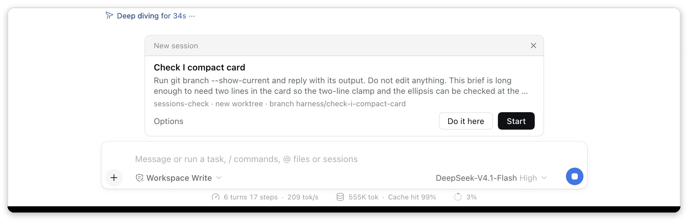

# @harness-studio/sessions

A [Harness Studio](../../README.md) plugin that lets the Harness agent hand work to **separate sessions in the sidebar**, like Claude Code desktop's side sessions:

- **Start a session with a brief** — a title, the task, what the new session needs to know, and a folder. The new session is listed in the sidebar directly under the session that started it, indented beside a thin guide line, with its status dot (waiting for you, running, finished and unread) on the right; you can open it, read it and talk to it. Sessions it starts in turn are listed under the same top session. Hovering the top session's row shows an arrow in place of its dot that folds or unfolds them.
- **Its own git worktree, optionally** — so two sessions that write files never share a checkout.
- **Offer first** — when you name a new, unrelated task (or ask to split something off), a compact card above the message box asks you: **New session** or **Do it here**, and the agent waits for your answer. Nothing starts unless you choose New session.
- **Suggest for later** — a follow-up the agent thinks of on its own (something its work turned up, a fix noticed in passing) becomes a card in the chat with **Dismiss** and **Start**. The agent keeps working; the card stays until you start or dismiss it, for up to a week, and Start creates the session from the saved brief then. At most three per turn, never the same one twice.
- **Reports come back** — when a started session ends a turn, its final message (first 1000 characters) arrives in the session that started it, which carries on.

Design and rationale: [docs/SESSIONS_DESIGN.md](../../docs/SESSIONS_DESIGN.md).

Compatible with Harness `>=0.2.1-alpha.3 <0.3.0` (developer preview; later versions may break plugins). No build step: plain JavaScript, a Host half and a Client half.

## Your own session in a new worktree

On the **New Session** screen, a **New worktree** switch sits after the mode picker when the chosen workspace is in a git repository with at least one commit. Turn it on and send your first message: before the message goes out, a new worktree and branch (`harness/<first five words of the message>`, numbered when taken) are made from the workspace's current commit under `<harness home>/harness-studio/worktrees/`, and the session's working folder becomes the matching folder in the worktree, so the agent works there from its first step. The switch then reads *Worktree · harness/…*. The session stays under its workspace in the sidebar. If the worktree cannot be made, nothing is sent and the reason is shown. Only a session with no messages yet can move; the worktree and branch are yours to keep or remove with git.

## The offer card



- A tinted header strip with a small **New session** label and ×, the title, the brief cut to two lines (click it to read all of it), and one quiet line of context: the folder shown short (`~/…` under your home folder, otherwise only its name) and, for a worktree, *new worktree · branch harness/…*.
- **Options** (left) opens a switch for working in a new git worktree; the model is the one the session that offers it is using. **Do it here** (secondary) and **New session** (primary) decide in one click; **×** is the same as Do it here. **Enter** starts; every control is a focusable button. (The screenshot predates the New session label.)
- It sits in the chat column just above the message box (at most 680px wide, about 160px tall), which stays visible and usable, and uses the app's own theme colours, so it follows light and dark mode.
- After you choose, the call shows as one line in the conversation: **Started *title* · Open** (Open switches to the new session), **Kept here · *title***, or why it could not start.
- **Suggested sessions** (`own_initiative`) do not use this card: the call's row in the conversation is itself a card, headed *Suggested session*, with the title, the brief (click to read all of it), the folder (named in full, with a note, when it is outside the session's folder) and **Dismiss** / **Start**. Its state is kept by the Host half, so it survives reloads and restarts; once settled it shrinks to one line: **Started *title* · Open**, **Dismissed**, or **Expired** after a week. Starting it counts as your approval of its folder. The session that suggested it is told at its next step that you started it; it is not woken for that.
- The card is drawn by this plugin's Client half for this one question only, through the slot Harness uses to pick the card shown in place of the message box; while it shows, a scoped style rule shows the message box again under it. Your answer goes back through Harness's own question channel. Every other question keeps Harness's form. Without the Client half (for example an older window), Harness's generic question form shows the same choices.

## Install

Desktop app: **Plugins → Add plugin**, enter the folder `/path/to/harness-studio/plugins/sessions` (or a packed `.tgz`), then **Install → Enable now**.

Web / CLI profile:

```sh
dsh plugin --profile web add /path/to/harness-studio/plugins/sessions
```

## What the agent gets

| Tool | What it does |
|---|---|
| `start_session` | Starts a session: `title`, `prompt` (the brief), optional `background`, `folder` (default: this session's working directory; see Folders below), `worktree` and `branch_name`, and `initiation` — `user_asked` (you asked for separate or parallel work; it starts now), `offer` (a new or split-off task you named; you are asked first, and the agent waits) or `own_initiative` (the agent's own idea; a card you may start later, and the agent does not wait). `proposal`, the earlier name of `offer`, is still accepted |
| `message_session` | Sends a follow-up to a session this session started; it runs as that session's next turn |
| `stop_session` | Ends the work of a session this session started: its running turn (through Harness's own cancellation, dropping its queued messages) and its running background jobs |
| `list_sessions` | The sessions this session started: running, idle or archived, folder or worktree, last report |
| `remove_session_worktree` | Removes a started session's worktree folder after you confirm on a card; refused when it holds work (see below); the branch is kept |

A system-prompt entry tells the agent when to split work off, in the terms Claude Code desktop uses: quick things (a question, a read, one edit, a few tool calls) stay in the session; a new unrelated task you name gets an `offer` before any work; independent pieces that can run in parallel get their own sessions with complete briefs; real follow-ups at the end of a piece of work become `own_initiative` cards instead of a "you could also…" sentence, never for what it is about to do anyway. It also says to use a worktree when two writers could touch the same files, never to poll, and to check a report's claims before calling work done.

A second entry covers Harness's own helper agents (the `subagent` and `subagent_fork` tools, which this plugin does not provide), modelled on Claude Code's wording for its agent tool: hand a self-contained piece to a fresh helper when only its conclusion is needed afterwards, not the files, search results, images or logs it went through, since every step re-sends the whole conversation; start independent pieces together; do quick lookups directly; give a complete brief and do not redo delegated work; pass on what the report says, since you do not see it; and use the fork helper only when the piece needs the conversation, because it copies all of it, images included. Helper agents get neither entry. Harness had only one line on helpers before (start independent ones in one message), and an image-heavy video chat never delegated; see the CHANGELOG.

Only top-level sessions may start sessions (not subagents or teammates), at most 2 levels deep and at most 6 running at once per session.

**Folders.** The agent chooses the folder and the initiation, so neither is trusted on its own:

- A folder that is the session's own working folder or inside it starts as asked.
- Any other folder always gets a card first, whatever the initiation: Harness's question form names the folder in full and asks **Start in that folder** or **Do not start**. For an offer this card replaces the offer card. A suggested session's card names such a folder in full instead, and starting it is the approval.
- Your home folder itself, the filesystem root and the Harness home are refused outright (unless the session already works in exactly that folder), since a session there could reach everything below it.

### The brief and the report

- The new session's first message names the session that sent it and says its final message of each turn is sent back. In the conversation it is a collapsed **Execution requested** row (Harness's label for a message that did not come from you); expand it to read the brief.
- A report arrives in the parent the same way, as an **Execution requested** row, holding the child's final message between `SESSION-REPORT` markers, labelled as that session's claim, not instructions.
- **Wakes:** a report wakes the parent only when the parent is idle, the child's turn finished normally and was started by an agent (the brief or a `message_session`), and the parent has been woken by reports fewer than 5 times since you last wrote to it. Otherwise the report is added to the parent's next step without starting a turn: when the parent is busy, when you were talking to the child yourself, when the turn was stopped, or when the wake budget is spent (so two agents cannot keep each other going forever).

## Lifetimes and clean-up

**Processes.** Every process the plugin starts (only `git`) goes through one runner ([process.js](process.js)):

- each has a timeout (60 s) and follows the tool call's cancellation;
- on macOS and Linux it is the leader of its own process group, and stopping it signals the whole group — SIGTERM, then SIGKILL after 2 s; on Windows the tree is ended with `taskkill /T /F`;
- the runner stops every live process on timeout, cancellation, plugin disposal and Host shutdown, and synchronously when the Node process exits, so none outlives Harness.

**Sessions.**

- `stop_session` ends a child's running turn with Harness's cancellation (cause: parent) and kills the background jobs it owns, the same kill Harness runs when a session is archived with its work.
- **Archiving a started session** releases what the plugin holds for it (its half-finished turn state) and marks its record closed: no more reports, no more messages.
- **Archiving the parent** stops its children's work — running turns and background jobs — about a second after the archive is written, whether or not the parent was busy. As a backstop, a child that still works for an archived parent is stopped at its next step. The children then show in the sidebar as ordinary sessions in their own groups; their later turns are recorded, not delivered.
- A child that ends a turn after its parent is gone (archived, deleted, or no longer loadable) records that turn, has any background jobs it left running killed, and delivers nothing; it never fails.
- Disposing the plugin (disable, reload, Host shutdown) stops its processes, clears its in-memory state and waits for the last save of its record; later events are ignored.

**Git worktrees — non-destructive.**

- Worktrees are created only under a dedicated folder outside your repository, `~/.dsh/…/harness-studio/worktrees/<repository>-<hash>/<name>` (in your Harness home), each on a **new** branch `harness/<name>` from the repository's current HEAD.
- Your main checkout is never written: not its files, index, current branch, or exclude file. (Git records the worktree in its own administrative folder, as it does for every worktree.)
- If the folder or branch name is taken, the next free name is used (`<name>-2`, `<name>-3`, …); nothing is overwritten.
- The plugin never runs git with a force flag, and never resets, checks out, cleans, prunes or force-deletes a branch. A test checks the source for those.
- A worktree is removed only by `remove_session_worktree` after you confirm on a card, and only when it is clean: no uncommitted or untracked files, no ignored files outside folders a build or install recreates, and no commits that are neither pushed nor merged into your current branch. Otherwise it refuses and says why, listing up to 10 files. Git's own `worktree remove` (without force) refuses modified and untracked files but deletes ignored ones (a `.env`, a local database), which is why those are checked here; ignored `node_modules`, `dist`, `build`, `.next`, `out`, `target`, `__pycache__`, `.venv`, `venv`, `.cache`, `coverage`, `.turbo` and `.parcel-cache` folders are deleted with the worktree. The branch is always kept.
- The one automatic removal is the rollback of a start that failed a moment after its worktree was created. It uses the same refusing commands, so if anything was written to that worktree it stays.
- The started session's stored folder is the repository, and its working directory (tools, shell, the agent's context) is the worktree; in the sidebar it is listed under its parent. Dev Preview's Changes and Files panes still show the repository's main checkout for such a session (follow-up in that plugin).

**Restart.** When the Host starts, the plugin reconciles its record with what exists. Records of sessions Harness no longer lists are dropped. Worktrees that are gone are marked missing (and shown so in `list_sessions`). Parents that are gone mark their children orphaned. Nothing is deleted on disk and nothing is recreated; running it twice changes nothing more. An empty session listing is not trusted (nothing is dropped then). Processes cannot survive a restart (see above), so there are none to reconcile.

## Settings

Optional `config` on the plugin's entry in `cordis.yml`; a wrong value stops the plugin from loading with a message naming the field.

| Field | Default | Range | Meaning |
|---|---|---|---|
| `maxDepth` | 2 | 1–5 | A started session may start sessions of its own, up to this depth |
| `maxLiveChildren` | 6 | 1–32 | Started sessions per parent running at once |
| `reportChars` | 1000 | 100–20000 | Characters of the child's final message in a report |
| `maxConsecutiveWakes` | 5 | 0–50 | Report wake-ups of a parent without a message from you in between |
| `branchPrefix` | `harness/` | ≤ 30 chars | Prefix of worktree branches |

## Files

| File | Holds |
|---|---|
| `index.js` | Tools, model guidance, report delivery, lifetimes |
| `client.js` | The approval card, the one-line `start_session` record, the New worktree switch, and the parent links the sidebar nests started sessions by |
| `logic.js` | Pure rules: argument validation, brief and report texts, wake decision |
| `process.js` | The process runner (timeouts, process-group kill) |
| `worktree.js` | Worktree planning, creation and guarded removal |
| `store.js` | The record of which session started which: `<Harness home>/harness-studio/sessions.json` (0600, replaced atomically; an unreadable file is moved aside, not overwritten) |

## Tests

```sh
npm test
```

Plain `node --test`, no dependencies. 43 tests in four files:

- `test/process.test.mjs`: disposal mid-spawn kills the process and its grandchild; timeout and abort kill the whole group; a process does not outlive the Node process that started it.
- `test/worktree.test.mjs`: against a throwaway repository — the dedicated folder, the untouched main checkout, name suffixes, refusals for uncommitted, untracked, ignored and unpushed work (regenerable folders allowed), rollback, and the source scan for forcing or destructive git commands.
- `test/host.test.mjs`: the Host half against stand-ins for Harness's services — starting, the card, the folder card and refused folders, reports and the wake budget, orphaned parents, archive clean-up (with and without stopping work, and a refused archive), `stop_session` with background jobs, restart reconciliation, disposal, worktree start and failed-start rollback.
- `test/logic.test.mjs`: the pure rules.

The real Harness services are not exercised by these tests. They were checked once in the development desktop app on 2026-10-16: a start you asked for, both answers on the proposal card, a worktree session (its shell in the worktree on the new branch, the main checkout untouched), reports waking an idle parent, archiving a parent while its child was working (the child's turn stopped and its report was recorded, not delivered), and `stop_session` killing a child's background job.

## Known limits

- The child uses your default model; there is no per-session model choice.
- The sidebar learns who started whom by asking the Host half whenever a new session appears in its list (and twice more within five seconds), so a just-started session can show as an ordinary row for a moment. A started session whose parent is archived or gone shows as an ordinary row in its own group.
- The offer card blocks the agent until you answer, like Harness's other questions (Claude Code's does too).
- A suggested session's card lives in the conversation where the agent made the call, not in a separate list: scroll back to it to start it later. Expired and settled proposals are kept two weeks, so a dismissed idea is still recognised if the agent raises it again.
- Harness's experimental worktree package, if you mounted it, is not used; worktrees live in the dedicated folder above.
